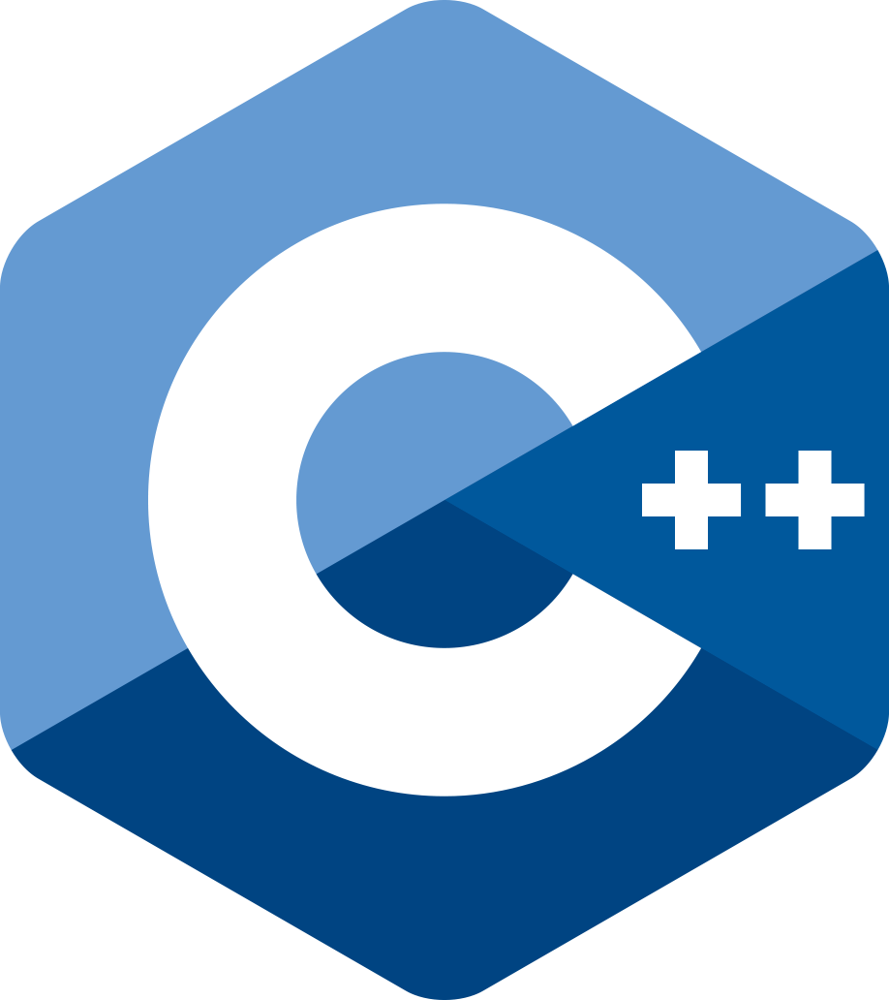
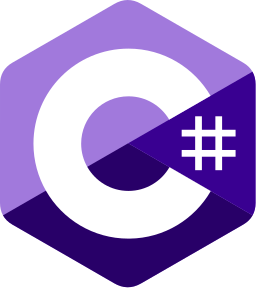
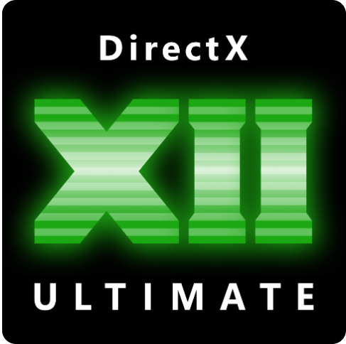
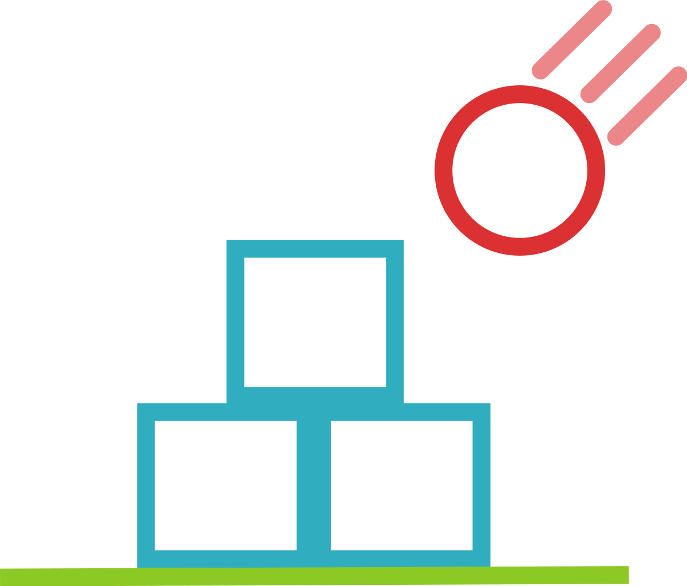
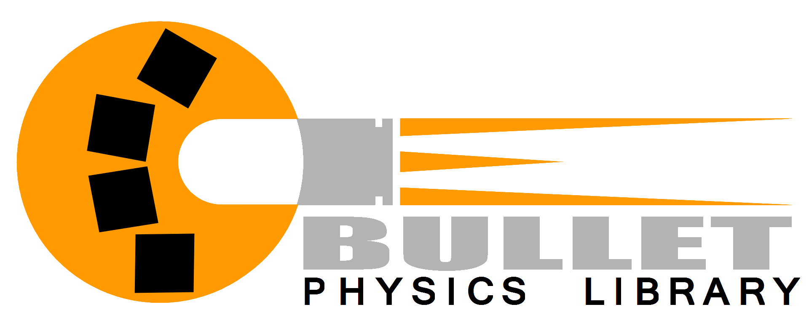

## Hi there 👋! My name is Leonid and I'm a Software Engineer from Moldova

---

## About Me

I am a student at the Moldova State University. 
I'm interested in programming and am involved in a university project. 
I'm skilled in computer graphics. 
I lead a team that develops a game engine and games based on it.

--- 

## 🛠️ My Tech Stack

### 💻 Programming Languages

   &nbsp&nbsp
   &nbsp&nbsp
   &nbsp&nbsp
   &nbsp&nbsp
   &nbsp&nbsp

### ⚙️ Technologies I have studied
<!-- 
 -->
<!-- 

  
  
  

 -->

| Graphics | Physics |
|:---:|:---:|
|  |   |
|   |   |
|   |  |

### 🖥️ Platforms I work with

  
  
   

---

### 🎨 Interests & Hobbies

- 🦢 Origami  
- 🔢 Mathematics  
- 🎙️ Voicing of characters  
- 🎮 Playing games  
- 🧩 Game development & modding  
- 🧰 Fixing and repairing PC

---

<!--
**leopard-bf187/leopard-bf187** is a ✨ _special_ ✨ repository because its `README.md` (this file) appears on your GitHub profile.

Here are some ideas to get you started:

- 🔭 I’m currently working on ...
- 🌱 I’m currently learning ...
- 👯 I’m looking to collaborate on ...
- 🤔 I’m looking for help with ...
- 💬 Ask me about ...
- 📫 How to reach me: ...
- 😄 Pronouns: ...
- ⚡ Fun fact: ...
-->
